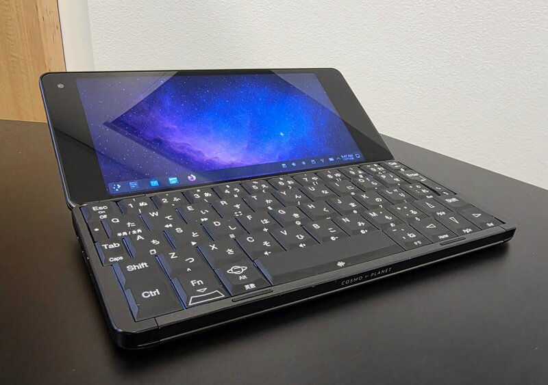
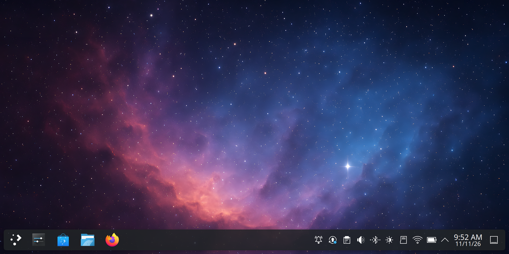
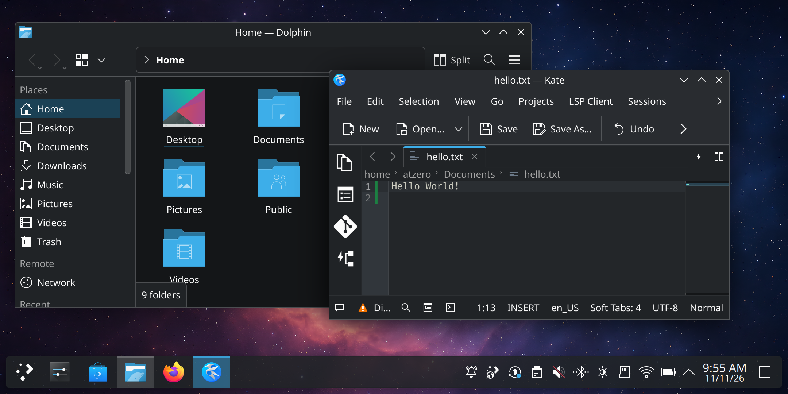
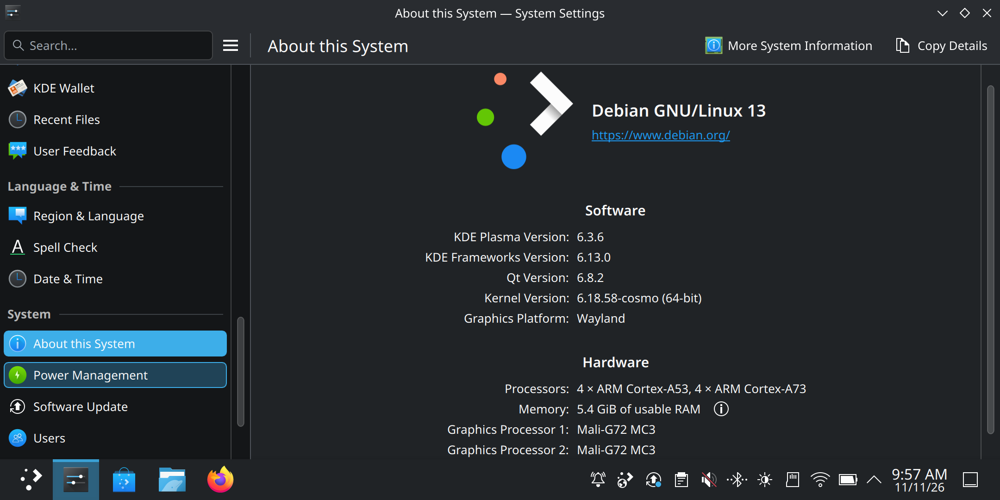

# cosmo-linux618



**[Download and install](docs/install.md)**

Mainline Linux **6.18 LTS** for the Planet Computers **Cosmo Communicator**
(MediaTek MT6771 / Helio P70), replacing Gemian's vendor 4.4 kernel. The
root filesystem is a fresh Debian trixie install built by
[gemini-debian](https://github.com/atzandrew/gemini-debian) (`DEVICE=cosmo`),
with a Plasma Wayland desktop.

The approach follows the Gemini PDA projects
([gemini-nixos](https://github.com/atzandrew/gemini-nixos),
[gemini-debian](https://github.com/atzandrew/gemini-debian)): a pinned
upstream kernel plus a small tree of changed files. The Cosmo needs far less
than the Gemini did, because its MT6771 is register-compatible with the
MT8183 that mainline already supports well. Where the hardware needs
specific values, they are taken from the stock kernel and device tree.

## Status

**Beta.** Most everyday functions work on my device. Beta images
are on the [releases page](https://github.com/atzandrew/cosmo-linux618/releases):
read [docs/install.md](docs/install.md) before flashing, and see
[docs/beta-testing.md](docs/beta-testing.md) for what to test and how to
report problems.

**No mobile functionality.** Calls, SMS, mobile data and the SIM slot
do not work yet; use Wi-Fi. Cameras and GPS do not work either.

**Working**
- Boot, display, GPU (panfrost, Mesa 26.1 from Debian backports, GLES 3.1),
  Plasma Wayland, SDDM login
- Touchscreen, keyboard and keyboard backlight, power key, lid
- Wi-Fi, Bluetooth (pairing, mice, keyboards and audio; reconnects
  after sleep)
- Speaker and headphones
- Charging, including USB-C PD fast charging; battery level
- Deep sleep at stock power draw (~85 mA): closing the lid sleeps,
  opening it, Esc or the power key wake
- USB device mode on the left port; host mode on both ports (automatic on
  the right, selected by hand on the left)
- microSD
- Cover display shows time and battery
- CPU frequency scaling, CPU idle power-down, thermal limits, RTC

**Known issues**
- After sleep, the right USB-C port may stop working until a restart.
- USB power output on the left port stops after the first sleep.
- Wi-Fi is switched off during sleep and back on at wake.
- No headset microphone, and plugging headphones in is not detected.
- The bootloader shows its orange-state warning at every boot.
- The GPU may log errors (and briefly stall) when a web page starts 3D
  graphics (WebGL).

**Not supported yet**
- Modem: phone calls, SMS, mobile data, SIM card
- GPS
- Cameras
- Screen rotation and other sensors
- HDMI out, vibration, NFC, fingerprint reader
- WPA3 Wi-Fi (planned soon). Networks that offer both WPA2 and WPA3
  connect over WPA2 automatically; WPA3-only networks do not work yet.

**Screen variants: read before flashing.** Cosmos were made with two
different screens. Only the **NT36672** screen is supported; units with
the **SSD2092** screen (and its Solomon touch controller) are not. The
install guide shows how to check which one a unit has. The kernel refuses
to drive any other screen and powers the device off, but **that refusal
has never been tested on an SSD2092 unit**, as none was available: do not
rely on it.

**I have only tested on my device.** The CPU voltage tables have not been
checked on other units. Do not flash this on a device you cannot recover with mtk.

## Build

Needs gcc for arm64 (native on an arm64 host, otherwise the cross
`aarch64-linux-gnu-gcc`), plus `flex`, `bison`, `bc` and the OpenSSL and
libelf headers:

- Debian/Ubuntu: `flex bison bc libssl-dev libelf-dev`
- Fedora: `flex bison bc openssl-devel elfutils-libelf-devel`

```sh
bin/build-kernel.sh dtbs   # device tree only (fast check)
bin/build-kernel.sh        # Image.gz, DTB, modules → out/
```

The first run clones the pinned stable tag into `build/src`.

## Source code and licences

The kernel and everything in this repository are GPL-2.0 (`LICENSE`).

- **Kernel:** each release names the commit of this repository it was
  built from; `kernel/BASE` in that commit pins the upstream stable tag.
- **Rescue initramfs** (inside `boot.img`): `initramfs/` and
  `bin/build-boot-img.sh` from the same commit, plus these binaries
  copied unchanged from Fedora 44 aarch64 packages. Their source is in
  the matching Fedora source packages (`dnf download --source <name>`,
  or [src.fedoraproject.org](https://src.fedoraproject.org/)):
  - busybox 1.37.0-7.fc44 (GPL-2.0)
  - kexec-tools 2.0.32-3.fc44 (GPL-2.0)
  - glibc 2.43-9.fc44, zlib-ng-compat 2.3.3-3.fc44, xz-libs 5.8.2-2.fc44,
    libzstd 1.5.7-5.fc44 (libraries used by kexec)
- **Root filesystem:** Debian trixie packages, built by
  [gemini-debian](https://github.com/atzandrew/gemini-debian); their
  source is in the Debian archive. Wi-Fi and Bluetooth firmware are not
  shipped: on first use they are copied from the Cosmo's own Android
  vendor partition.
- `kernel/delta/drivers/misc/mediatek-connectivity/` comes from Planet's
  GPL release of the Cosmo 4.4 kernel. Some of its files still carry
  MediaTek's original headers; the code was published under the GPL as
  part of that kernel.

## Documentation

- `docs/install.md`: installing the beta, backup and going back to Android
- `docs/beta-testing.md`: what to test, known issues, reporting problems
- `docs/bringup-checklist.md`: every hardware block and its state
- `docs/hardware-map.md`, `docs/stock-reference.md`: hardware and stock values
- `docs/session-log.md`: bring-up history and test results

## Screenshots






